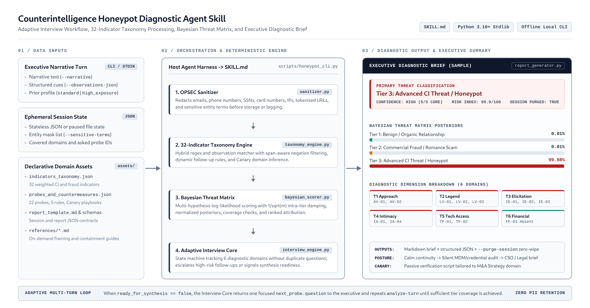

# Counterintelligence Honeypot Diagnostic Agent Skill (`executive-honeypot-detector`)

## 1. Overview

The Counterintelligence Honeypot Diagnostic Agent Skill is a modular, harness-agnostic Agent Skill for corporate executives, board members, Chief Security Officers (CSOs), and executive protection teams. It evaluates whether a new romantic relationship exhibits behavioral and operational indicators consistent with:

- **Tier 1: Benign / Organic Relationship** (verifiable background, organic meeting genesis, balanced reciprocity)
- **Tier 2: Commercial Fraud / Romance Scam** (financial opportunism, opaque wealth claims, urgent monetary solicitation without corporate IP targeting)
- **Tier 3: Advanced CI Threat / Honeypot** (targeted approach, shallow cover legend, covert elicitation of corporate secrets, physical device proximity)

### Capabilities and Architecture
Targeted human intelligence (HUMINT) exploitation bypasses technical security perimeters by exploiting interpersonal trust. This skill operationalizes counterintelligence tradecraft into a structured diagnostic workflow and an optional standalone browser dashboard:

- **Adaptive Multi-Turn Interview Engine (`scripts/interview_engine.py`)**: Replaces static checklists by tracking coverage across six diagnostic domains and escalating dynamically when high-risk indicators appear.
- **32-Indicator Tradecraft Taxonomy (`assets/indicators_taxonomy.json`)**: Maps narratives and structured observations against 32 weighted counterintelligence and romance-fraud indicators with span-aware negation handling.
- **Damped Bayesian Threat Matrix (`scripts/bayesian_scorer.py`)**: Computes reproducible, normalized posterior probabilities with intra-tier correlation damping and per-indicator log-likelihood attribution.
- **OPSEC Redaction and Ephemeral Sessions (`scripts/sanitizer.py`)**: Redacts emails, telephone numbers, SSNs, card numbers, IP addresses, tokenized URLs, and configured entity names prior to ephemeral storage or reporting, and supports zero-byte overwrite deletion of temporary session files.
- **Non-Escalatory Defensive Protocols (`scripts/report_generator.py`)**: Generates structured JSON and Markdown diagnostic reports, MDM/credential containment steps, privileged CSO escalation guidance, and domain-tailored passive Canary Protocol scripts.
- **Dual-Mode Standalone HTML Dashboard (`scripts/build_dashboard.py`, `assets/dashboard_template.html`, `dashboard.html`)**: Emits a single-file offline HTML interface supporting both post-session visual reporting (turn-by-turn Bayesian trajectory, 32-indicator log-likelihood attribution table, interactive 3D Threat Topology with WebGL and software 2D projection fallback) and direct volatile-RAM in-browser interviewing with client-side OPSEC redaction, JSON import/export, and Light/Dark/System themes.
- **Ready-to-Load Sample Artifacts (`examples/sample_session.json`, `examples/sample_report.json`)**: Demonstrates the exact sanitized session and report JSON schemas accepted by both the CLI builder and the browser `Load JSON` control.

For detailed architectural specifications, mathematical derivations, and error-handling contracts, see `documents/prd.md`. For dashboard visual and theme specifications, see `DESIGN.md`.



---

## 2. Project Structure

All paths are relative to the project root directory:

```text
.
|-- .gitignore                               # Git ignore rules for virtualenvs, caches, and scratch/
|-- DESIGN.md                                # Standalone dashboard visual, layout, and theme specification
|-- LICENSE                                  # Apache License, Version 2.0
|-- README.md                                # Setup, CLI usage, dashboard build, and end-user guide
|-- SKILL.md                                 # Agent skill metadata and multi-phase orchestration workflow
|-- dashboard.html                           # Pre-built standalone interactive diagnostic dashboard
|-- requirements.txt                         # Test and YAML validation dependencies
|-- assets/
|   |-- dashboard_template.html              # Self-contained HTML/CSS/JS dashboard source template
|   |-- indicators_taxonomy.json             # 32 weighted CI and fraud indicators plus prior profiles
|   |-- probes_and_countermeasures.json      # Adaptive probes, dynamic rules, and Canary playbooks
|   |-- report_template.md                   # Markdown executive diagnostic report template
|   |-- skill_architecture_flow.png          # End-to-end architecture and diagnostic workflow diagram
|   `-- schemas/
|       |-- report_schema.json               # Final diagnostic report JSON schema
|       `-- session_schema.json              # Ephemeral session JSON schema
|-- documents/
|   `-- prd.md                               # Product Requirements Document
|-- examples/
|   |-- sample_report.json                   # Sample diagnostic report JSON for CLI and Load JSON
|   `-- sample_session.json                  # Sample sanitized multi-turn session JSON for CLI and Load JSON
|-- references/
|   |-- defensive_protocols.md               # Containment, Canary Protocol, and escalation manual
|   |-- interview_playbook.md                # Psychological framing and adaptive pacing rules
|   `-- tradecraft_taxonomy.md               # Detailed reference for all 32 indicators
|-- scripts/
|   |-- __init__.py                          # Relative path resolution, logging, typed exceptions
|   |-- bayesian_scorer.py                   # Damped multi-hypothesis Bayesian Threat Matrix
|   |-- build_dashboard.py                   # Standalone HTML dashboard builder with OS theme detection
|   |-- honeypot_cli.py                      # Unified CLI entrypoint
|   |-- interview_engine.py                  # Adaptive state machine and probe selector
|   |-- report_generator.py                  # Executive Markdown/JSON brief generator
|   |-- sanitizer.py                         # OPSEC redaction, path checks, and secure file purge
|   `-- taxonomy_engine.py                   # Taxonomy validator and hybrid indicator extractor
`-- tests/
    |-- __init__.py                          # Test package marker
    |-- fixtures/
    |   `-- synthetic_scenarios.json         # Synthetic multi-turn test scenarios
    |-- test_compliance_audit.py             # Layout, frontmatter, and relative path checks
    |-- test_dashboard_builder.py            # Dashboard build, theme token, and Python-vs-JS parity tests
    |-- test_system_cli.py                   # End-to-end CLI smoke and scenario tests
    |-- test_unit_bayesian.py                # Bayesian normalization and damping unit tests
    |-- test_unit_interview.py               # State machine and probe selection unit tests
    |-- test_unit_report.py                  # Report rendering and Canary tailoring unit tests
    |-- test_unit_sanitizer.py               # Sanitization and secure purge unit tests
    `-- test_unit_taxonomy.py                # 32-indicator loading and extraction unit tests
```

---

## 3. Prerequisites

- **Operating System:** Linux, macOS, or Windows with standard terminal access.
- **Python Version:** Python 3.10 or later (`python3 --version`).
- **Runtime Dependencies:** All core modules in `scripts/` use only the Python 3.10+ standard library.
- **Browser (Optional for Dashboard):** Any modern desktop browser supporting HTML5 and JavaScript (WebGL is used when available, with an automatic 2D software projection fallback).
- **Test and Validation Dependencies:** Listed in `requirements.txt` (`PyYAML` and `pytest`). Node.js is optional and enables automated Python-vs-JavaScript parity tests in `tests/test_dashboard_builder.py`.

### Virtual Environment Setup

Run the following commands from the project root directory:

```bash
python3 -m venv .venv
source .venv/bin/activate
python3 -m pip install --upgrade pip
python3 -m pip install -r requirements.txt
```

Optional environment variables:
- `HONEYPOT_SKILL_ASSETS_DIR`: Override path to the declarative `assets/` directory (defaults to `./assets`).
- `HONEYPOT_SKILL_LOG_LEVEL`: Set stderr logging verbosity (`DEBUG`, `INFO`, `WARNING`, `ERROR`; defaults to `WARNING`).

---

## 4. Local Execution

All CLI commands execute locally and offline from the project root directory with zero outbound network calls.

### 4.1 Validate Declarative Assets
Confirm that all 32 indicators, conditional likelihoods, prior profiles, probes, and dynamic rules are consistent:

```bash
python3 scripts/honeypot_cli.py validate-taxonomy
```

Expected output: JSON object with `"status": "ok"` and `"indicator_count": 32`, exiting with code `0`.

### 4.2 Run a Diagnostic Session via CLI

The examples below store temporary session artifacts inside `scratch/`, which is excluded from version tracking by `.gitignore`:

1. **Initialize an ephemeral session** (optionally registering sensitive terms to redact):
   ```bash
   python3 scripts/honeypot_cli.py init-session \
     --risk-profile high_exposure \
     --sensitive-terms "Partner-Placeholder" "Apex Synthetic Corp" \
     --session-file scratch/ephemeral_diag.json
   ```

2. **Analyze executive narrative turns** (with optional structured indicator observations):
   ```bash
   python3 scripts/honeypot_cli.py analyze-turn \
     --session-file scratch/ephemeral_diag.json \
     --narrative "We met unexpectedly at a hotel bar during an overseas aerospace conference in Geneva where my keynote schedule was publicized online." \
     --observations-json '[{"id": "AV-01", "status": "present", "confidence": 0.90}, {"id": "AV-02", "status": "present", "confidence": 0.90}]'
   ```
   Inspect `next_probe.question` and repeat `analyze-turn` until `ready_for_synthesis` returns `true`.

3. **Run standalone Bayesian scoring** directly on structured observations:
   ```bash
   python3 scripts/honeypot_cli.py score \
     --observations-json '[{"id": "AV-01", "status": "present", "confidence": 0.9}, {"id": "LV-02", "status": "present", "confidence": 0.9}, {"id": "IE-01", "status": "present", "confidence": 0.95}, {"id": "TP-02", "status": "present", "confidence": 0.95}]'
   ```

4. **Generate the final executive report and securely purge the ephemeral session file**:
   ```bash
   python3 scripts/honeypot_cli.py generate-report \
     --session-file scratch/ephemeral_diag.json \
     --output-md scratch/diagnostic_report.md \
     --output-json scratch/diagnostic_report.json \
     --purge-session
   ```
   The `--purge-session` flag overwrites `scratch/ephemeral_diag.json` with zero bytes and deletes it immediately after generating the report.

### 4.3 Build and Inspect the Standalone Dashboard

The dashboard builder (`scripts/build_dashboard.py`) embeds the full 32-indicator catalog, adaptive interview engine, and specified diagnostic data into a single self-contained HTML file:

1. **Build the default dashboard containing the five reference synthetic scenarios:**
   ```bash
   python3 scripts/build_dashboard.py --output dashboard.html
   ```

2. **Build a dashboard pre-loaded with a live sanitized session (before purging the session file):**
   ```bash
   python3 scripts/build_dashboard.py \
     --session-file examples/sample_session.json \
     --output scratch/session_dashboard.html \
     --no-scenarios
   ```

3. **Build a dashboard directly from a finalized report JSON file:**
   ```bash
   python3 scripts/build_dashboard.py \
     --report-json examples/sample_report.json \
     --output scratch/report_dashboard.html \
     --no-scenarios
   ```

Open the generated HTML file directly in any desktop browser. Both `examples/sample_session.json` and `examples/sample_report.json` can also be imported interactively via the top bar `Load JSON` button without rebuilding the HTML file.

### 4.4 Execute the Automated Test Suite
Run all unit, CLI system, dashboard parity, synthetic scenario, and repository structural tests from the project root directory:

```bash
python3 -m pytest -v tests/
```

The test suite uses synthetic placeholder fixtures in `tests/fixtures/synthetic_scenarios.json` and exits with code `0` when all checks pass.

---

## 5. Non-Technical User Guide

This guide explains how a non-technical executive, board member, or security advisor can run a confidential relationship risk assessment in two ways: through a conversational AI assistant (Workflow A) or directly inside a local web browser using `dashboard.html` (Workflow B).

### Workflow A: Conversational Assessment Inside an Agent Harness

Use this workflow when you prefer to talk through a situation in plain English inside an AI assistant that supports `SKILL.md` skills.

#### Step 1: Load the Skill Folder
1. Copy this project directory (`SKILL.md`, `scripts/`, `assets/`, and `references/`) into your assistant's configured skills folder.
2. Confirm that local Python 3.10+ execution is permitted by your assistant.
3. Open a private chat session. The assistant detects the skill automatically from `SKILL.md`.

#### Step 2: Describe the Situation in Plain Language
Use generic labels such as `"my partner"` or `"the company"` rather than real names, phone numbers, email addresses, or confidential deal names. Even if a real identifier slips into your message, the local scrubber masks it before scoring.

**Real-World Example 1 (International Conference Encounter):**
> "I met someone at a hotel lounge during an industry conference abroad where my speaking schedule was public. They claim to run an independent consulting boutique, but none of their business details appear online, and twice they steered dinner conversations toward our upcoming acquisition timeline. Can you run a confidential counterintelligence risk assessment?"

**Real-World Example 2 (Rapid Online Financial Request):**
> "Someone I connected with online two weeks ago is already talking about exclusivity and just asked me to wire funds to clear a sudden customs hold on an inheritance shipment. They have shown no interest in my company or work devices. Can you help me evaluate whether this is espionage, romance fraud, or something benign?"

**Real-World Example 3 (Long-Term Verifiable Introduction):**
> "I started dating someone introduced through a former colleague I have known for ten years. I have met their family and coworkers, they never probe about board business or ask to borrow my laptop, and there have been no financial requests. I would like a quick baseline check before our next business trip."

#### Step 3: Answer One Focused Question at a Time
The assistant runs `scripts/honeypot_cli.py` behind the scenes and asks one calm, direct follow-up question per turn rather than presenting a static checklist:

- **Opening Turn:** Establishes confidentiality and asks how and where you first met, who initiated contact, and what stood out.
- **Adaptive Follow-Ups (Turns 2-5):** Focuses only on uncovered or elevated risk areas: career verifiability, work-related curiosity, relationship pacing, physical access to corporate phones or laptops, and financial requests. Topics you already explained are skipped automatically.
- **Pause or Wrap Up Early:** You can stop at any point and ask for an interim assessment; any unexamined domains will be listed clearly as blind spots.

#### Step 4: Review the Diagnostic Brief and Optional Visual Dashboard
When sufficient dimensions are covered, the assistant purges temporary session files and presents a structured report covering:

1. **Executive Risk Summary:** Primary tier (`Tier 1: Benign / Organic Relationship`, `Tier 2: Commercial Fraud / Romance Scam`, or `Tier 3: Advanced CI Threat / Honeypot`), confidence level, and composite risk score (0-100).
2. **Bayesian Threat Matrix Posteriors:** Normalized probabilities across all three risk tiers.
3. **Diagnostic Dimension Breakdown:** Table summarizing all six domains, active indicators, reassuring disconfirming indicators, and unassessed blind spots.
4. **Prescribed Defensive Countermeasures:**
   - **Tier 1 (Benign):** Reassurance and routine executive security hygiene.
   - **Tier 2 (Commercial Fraud):** Immediate financial firewall, asset freeze, and independent identity verification.
   - **Tier 3 (Advanced CI Threat):** Calm behavioral continuity (do not confront the partner unilaterally), discreet corporate device inspection and password rotation, and privileged consultation with the Chief Security Officer (CSO) and Corporate General Counsel.
5. **Passive Behavioral Verification (Canary Protocol):** For elevated CI risk, a benign, non-material conversational verification script designed to be coordinated with corporate security before use.
6. **Optional Visual Brief:** If you ask for an interactive visual summary, the assistant can generate `dashboard.html` via `scripts/build_dashboard.py` before deleting the temporary session file.

---

### Workflow B: Direct Offline Assessment in Your Web Browser (`dashboard.html`)

Use this workflow when you want to conduct a completely private self-assessment or inspect a saved diagnostic report offline without an AI assistant.

#### Step 1: Open `dashboard.html` Locally
1. Locate `dashboard.html` in the project root directory and double-click it (or open it via `File -> Open` in your browser).
2. No internet server or account login is required. Everything runs locally inside your browser tab.
3. Use the three-icon theme control in the top-right navigation bar to switch between Light, Dark, and System appearance modes.

#### Step 2: Explore Built-In Scenarios or Load a Sample File
- **Case Selector Dropdown (Top Bar):** Switch between five pre-loaded synthetic reference cases (Organic Relationship, Commercial Romance Fraud, Advanced CI Honeypot, Partial Assessment, and High-PII Redaction) to understand how indicators change the probabilities and 3D Threat Topology.
- **Load JSON Button:** Click `Load JSON` in the top bar and select either `examples/sample_session.json` (full turn-by-turn trajectory, redacted excerpts, and adaptive probes) or `examples/sample_report.json` (finalized executive summary without raw narrative turns) to inspect a realistic external dataset.

#### Step 3: Conduct a Private Self-Service Interview in Volatile Memory
1. Click **Start New Interview** in the top bar. This clears the demo view and opens a clean interview workspace stored strictly in temporary browser memory (nothing is written to cookies, local storage, or disk).
2. Choose your **Baseline Risk Profile** (`Standard Executive Exposure` or `High Exposure: M&A / Defense / R&D`) and optionally type names or company terms into **Custom Sensitive Terms** so they are masked automatically.
3. Keep **Calm Focus Mode** checked if you prefer to hide live risk charts while answering questions, reducing emotional distraction until you are ready to review the results.
4. Type your response to each prompt using generic labels, optionally click any scoped quick-confirm cues (`Present` or `Absent`), and click **Submit Turn & Advance**.
5. When ready, click **Synthesize Assessment Now** to reveal your full Bayesian posterior breakdown, interactive 3D Threat Topology, monospaced indicator attribution table, defensive countermeasures, and tailored Canary Protocol guidance.

#### Step 4: Export or Purge Session Memory
- **Export JSON:** Download a sanitized report JSON file only if you plan to brief your CSO or General Counsel under privilege.
- **Purge RAM:** Click **Purge RAM** (or simply close the browser tab) to clear all interview entries, custom redaction terms, and assessment state from browser memory immediately.

---

## 6. License

This project is licensed under the Apache License, Version 2.0. See the [LICENSE](LICENSE) file in the project root for full terms and conditions.
